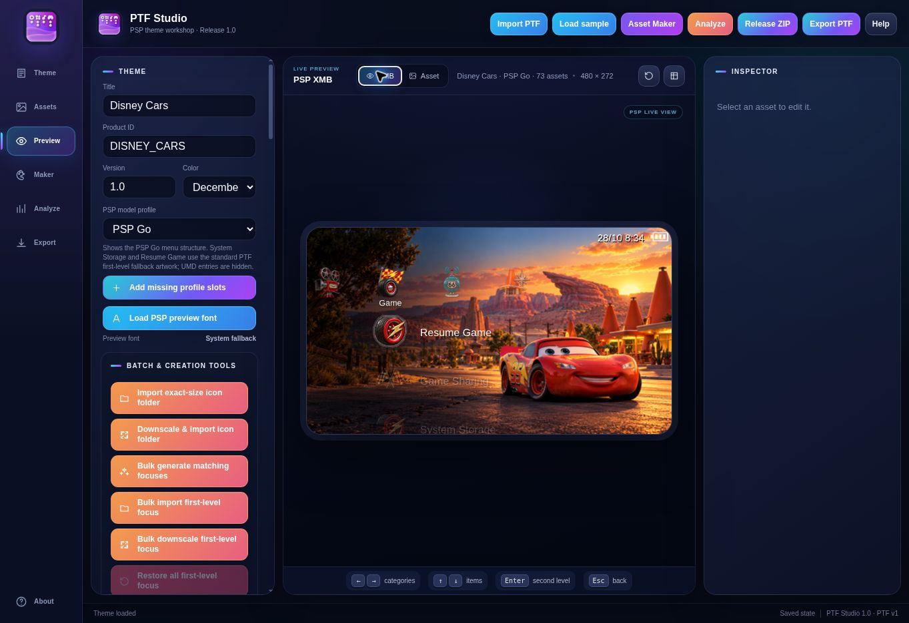

<div dir="rtl">

# تم غیررسمی Cars برای PSP — نسخهٔ آزمایشی ۱.۰

این پروژه یک تم PTF طرفداری با الهام از انیمیشن Cars است. تصویر پس‌زمینه و آیکون‌ها برای این پروژه با هوش مصنوعی ساخته شده‌اند. حقوق Cars و شخصیت‌های آن متعلق به دیزنی و پیکسار است؛ این تم محصول رسمی دیزنی، پیکسار یا سونی نیست. بازنشر دارایی‌های دارای حقوق اشخاص ثالث ممکن است به مجوز نیاز داشته باشد.



## امکانات و وضعیت

این نسخه در نرم‌افزار بررسی شده، و کاربر گزارش داده که فایل روی دستگاهش سالم کار کرده است؛ مدل و نسخهٔ سیستم‌عامل دستگاه مشخص نشده‌اند. تم شامل والپیپر ۴۸۰ × ۲۷۲، هشت آیکون دسته‌بندی، ۲۹ آیکون سطح اول و حالت انتخاب آن‌ها، دو آیکون سطح دوم و حالت انتخاب، تصویر و آیکون پیش‌نمایش است. تصاویر اضافی شخصیت‌های فیلم، همهٔ شخصیت‌های درخواستی و لوگوی رسمی Cars در این نسخه وجود ندارند. فایل‌های اصلی طراحی تصویرهای رستری هستند و لایه‌های قابل ویرایش تصویرسازی ندارند.

PTF Studio 1.0 فایل را باز کرد، ۷۳ دارایی تصویری را شناسایی کرد و در تحلیل خود صفر خطا و صفر هشدار گزارش داد. ابزار LibPSPThemes نیز فایل را استخراج و ۷۳ تصویر را رمزگشایی کرد. پیش‌نمایش PSP Go مشاهده شد؛ این پیش‌نمایش شبیه‌ساز کامل دستگاه نیست. سازگاری با مدل‌های PSP-1000، 2000، 3000، Go و E1000 هدف طراحی است، اما سازگاری سایر مدل‌ها روی سخت‌افزار تأیید نشده و منوها بسته به مدل و منطقه متفاوت‌اند.

در پیش‌نمایش PTF Studio، گزینه‌های حافظهٔ داخلی و Resume Game از آیکون جایگزین استاندارد استفاده می‌کنند. رفتار آن‌ها روی دستگاه واقعی تأیید نشده است.

## نصب

۱. فایل `build/Disney_Cars_PSP_Theme.ptf` را در پوشهٔ `PSP/THEME/` در ریشهٔ حافظه کپی کن. اگر پوشه وجود ندارد آن را بساز.

۲. در PSP Go، برای استفاده از حافظهٔ داخلی، در تنظیمات USB حافظهٔ سیستم را انتخاب کن و فایل را در پوشهٔ مربوط به همان حافظه قرار بده؛ یا از ریشهٔ Memory Stick استفاده کن.

۳. دستگاه را به‌صورت ایمن جدا کن و از مسیر **Settings → Theme Settings → Theme** تم را انتخاب و فعال کن. تم استاندارد PTF به CXMB نیاز ندارد.

## ساخت از منبع

Python 3، کتابخانهٔ Pillow و نسخه‌ای از [LibPSPThemes](https://github.com/GeofrontTeam/LibPSPThemes) لازم است. سورس ابزار خارجی در این بسته نیست:

</div>

```sh
python tools/extract_icons.py
python tools/build.py /path/to/LibPSPThemes
```

<div dir="rtl">

پوشهٔ `artwork/` تصویرهای اصلی، `assets/` تصاویر آمادهٔ PSP و حالت‌های انتخاب، `tools/` اسکریپت‌ها، `build/` فایل آزمایشی PTF و `screenshots/` تصویر پیش‌نمایش نرم‌افزاری را نگه می‌دارد. فونت یا فایل سیستم سونی در بسته نیست. خروجی ممکن است در نسخه‌های مختلف Pillow دقیقاً یکسان نباشد.

## اعتبارها

تصویرسازی طرفداری با ابزار تولید تصویر OpenAI ساخته شده است. ساخت PTF از LibPSPThemes و بررسی بصری از PTF Studio استفاده می‌کند. نام‌ها و نشان‌های Disney، Pixar، Sony و PSP متعلق به صاحبان آن‌ها هستند؛ هیچ همکاری یا تأیید رسمی ادعا نمی‌شود.

</div>
